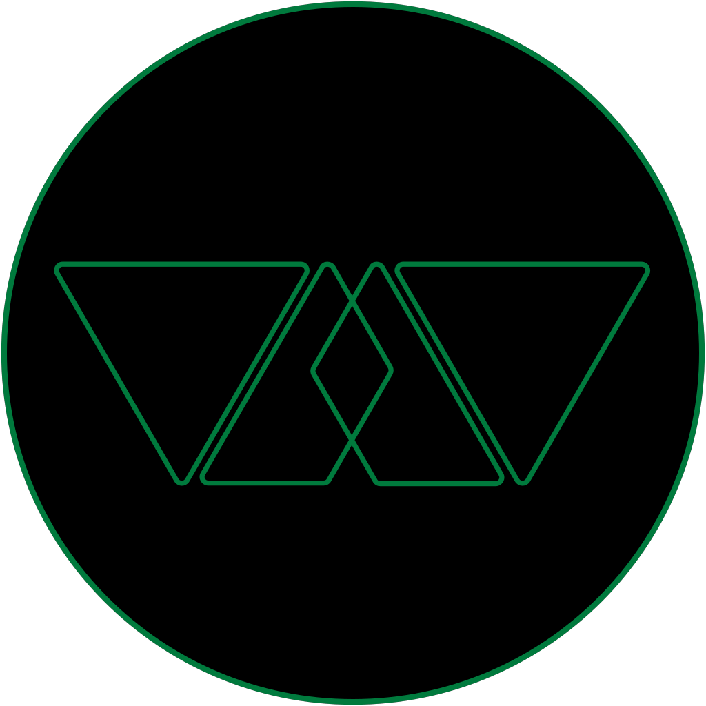
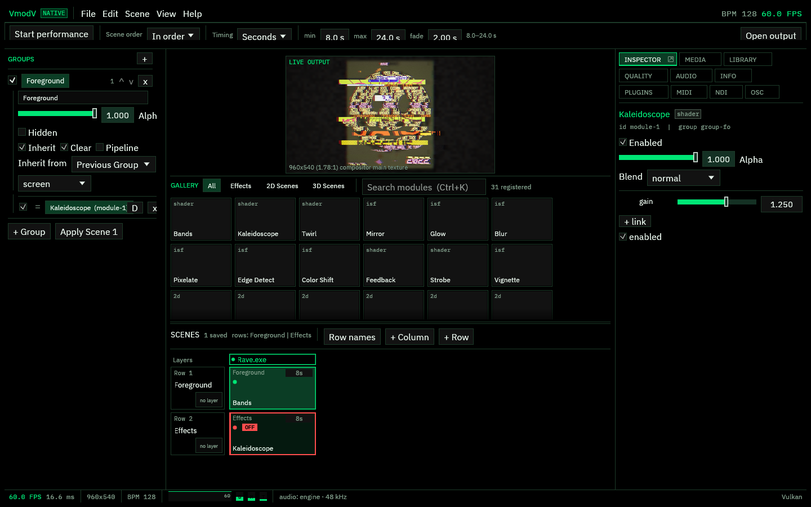

<p align="center">
  
</p>

<p align="center">
# VmodV
</p>

<p align="center">
  <a href="https://github.com/fayaaz/VmodV/releases/latest">
    
  </a>
  <a href="https://github.com/fayaaz/VmodV/blob/main/LICENSE" target="_blank">
    
  </a>
  <a href="https://github.com/fayaaz/VmodV/blob/main/THIRD_PARTY_NOTICES.md" target="_blank">
    
  </a>
</p>

*Modular audio visualisation for Linux*

VmodV is a vjing app — with a timeline, **Scenes** and **Performance**.

**tl;dr:** grab the latest AppImage or `.deb` from
[Releases](https://github.com/fayaaz/VmodV/releases) and start vjing.

<p align="center">
  
</p>

## What's inside

- **Scenes** — snapshots of the live output: the Groups' state (modules, alpha,
  effects) saved as a named Scene you can apply again or revisit later.
- **Performance** — orchestrate the scenes: a timeline that plays scenes on the
  performance grid, with individual transitionable groups.
- **Modules** — ISF shader corpus, Point10 scenes, 2D modules and user-supplied
  MilkDrop presets; audio-reactive inputs, MIDI, OSC, NDI and video capture.

> **License note:** VmodV's own code is MIT-licensed. It also bundles
> third-party modules and assets that are **not** MIT — several Shadertoy
> modules and the Point10/Plane9 scene ports are CC BY-NC-SA (no commercial
> use, share-alike). See [THIRD_PARTY_NOTICES.md](THIRD_PARTY_NOTICES.md) for
> the full per-file attribution before redistributing or selling a build.
> MilkDrop `.mlk` presets are **not** bundled; user-supplied presets are read in
> place and never redistributed — see
> [docs/milkdrop-presets.md](docs/milkdrop-presets.md).

## Install (Linux)

Linux only. Releases are cut from `main` automatically by SemVer rules
(`feat:` → minor, `fix:` → patch, breaking → major) — see
[docs/releasing.md](docs/releasing.md).

**AppImage** (any distro, no install):

```bash
chmod +x VmodV-*.AppImage
./VmodV-*.AppImage
```

If FUSE is missing, install `libfuse2`/`fuse` (package name varies by distro)
or run `./VmodV-*.AppImage --appimage-extract-and-run`.

**Debian/Ubuntu** (`.deb`, declares its runtime dependencies):

```bash
sudo apt install ./VmodV-*-amd64.deb
modv
```

Either way you need a Vulkan driver (any modern GPU driver, or
`mesa-vulkan-drivers` for the lavapipe software fallback), PipeWire or
PulseAudio for audio capture, ALSA, and GStreamer with the base/good/bad
plugin sets for video. The `.deb` pulls these in; AppImage users must have them
installed. Wayland is preferred; X11/XWayland works as a fallback.

User data (presets, Scenes, media profiles, logs) lives in `~/.config/VmodV` —
set `MODV_USER_DATA` to override. The packaged launcher tees stderr into
`~/.config/VmodV/logs/vmodv-YYYY-MM-DD.log`; "Open logs" in the UI opens that
folder.

## Windows and macOS (best effort)

Each release also carries portable builds — no installers, and no Linux feature
parity.

**Windows**: unzip `VmodV-Windows-x86_64-portable-<version>.zip` and run
`VmodV.cmd`. GStreamer ships inside the ZIP.

**macOS**: unzip `VmodV-macOS-arm64-portable-<version>.zip` (Apple Silicon) or
`VmodV-macOS-x86_64-portable-<version>.zip` (Intel), install GStreamer
(`brew install gstreamer gst-plugins-base`) and run `VmodV.command`. The
bundle is ad-hoc signed; if macOS blocks it, run
`xattr -dr com.apple.quarantine VmodV.app VmodV.command`.

Cameras, screen capture and system-audio monitor capture are Linux-only
(V4L2/PipeWire); rendering, audio input and MIDI work. User data goes to
`%APPDATA%\VmodV` on Windows and `~/Library/Application Support/VmodV` on
macOS; `MODV_USER_DATA` overrides both.

## Build

The host only needs Docker (with Buildx) and make — Rust, cargo and all build
dependencies live in the Docker toolchain image.

```bash
make build            # VmodV AppImage + .deb in dist/
make appimage-vmodv  # AppImage only
make vmodv-deb       # .deb only (runs vmodv-deb-check.sh)
make vmodv-deb-check # re-check an existing .deb
```

`VMODV_VERSION` names the installers. Its default comes from the git tags
(`vX.Y.Z` on HEAD, else the latest tag) via `tools/version.sh`; override it
with the environment variable (`make version` prints the resolved value):

```bash
make version
VMODV_VERSION=2.0.0 make build
```

Artifacts:

- `dist/VmodV-<version>-x86_64.AppImage`
- `dist/VmodV-<version>-amd64.deb`

## Development

```bash
make dev          # the app, release profile (Wayland preferred, X11 fallback)
make vmodv-debug # debug profile
make engine-run   # same binary through the engine entry point
```

`make dev` forwards the host Wayland/X11 session, PulseAudio and `/dev/dri`
(GPU) into the container. Override with `DISPLAY_BACKEND=x11` or
`DISPLAY_BACKEND=wayland`, and pass app flags with `ARGS="..."`.

## Tests

```bash
make engine-test                                    # full workspace
make engine-test ARGS="-p modv-engine --lib"        # one package
make engine-test ARGS="-p modv-app --test notices"  # one integration test
make test-e2e-vmodv                                # real-binary e2e + parity
make engine-lint                                    # clippy -D warnings + rustfmt
make format                                         # cargo fmt --all
```

The e2e harness drives the real `modv` binary over a JSON-lines control
socket; it prefers the host Wayland session, falls back to X11, and starts
Xvfb when there's no display at all. See
[docs/vmodv-e2e.md](docs/vmodv-e2e.md) and
[docs/vmodv-parity-map.md](docs/vmodv-parity-map.md).

## Under the hood

`crates/` is the whole app: `modv-engine` (state, Scenes, performance timing,
presets), `modv-render` + `modv-renderers` (wgpu compositor, ISF/2D/Point10),
`modv-media` (audio, GStreamer video, MIDI/OSC/NDI), `modv-ui` (egui panels)
and `modv-app` (the `modv` binary). VmodV is a fork of modV; the final Electron
implementation is archived on `legacy-electron` — see
[docs/legacy-electron.md](docs/legacy-electron.md).

| Path | Purpose |
| --- | --- |
| `crates/` | the Rust workspace (engine, renderers, media, UI, app) |
| `resources/isf/` | bundled ISF shader corpus |
| `resources/point10/textures/` | Point10 texture assets |
| `packaging/vmodv/` | AppImage/`.deb` launchers, desktop entry and control file |
| `tools/vmodv-*.sh` | packaging, checks and the packaged-app smoke suite |
| `tests/e2e-rust/` | committed VmodV e2e parity manifest |
| `docs/` | design, parity, release and legacy-archive notes |

## License

VmodV's own code is MIT — see [LICENSE](LICENSE). Bundled ISF shaders, Point10
scene ports, textures and Rust dependencies keep their own licences; see
[THIRD_PARTY_NOTICES.md](THIRD_PARTY_NOTICES.md).
